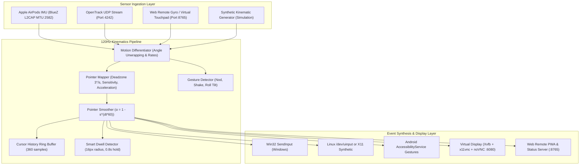

# AirCursor Cross-Platform System Architecture

## Zero-Internet Architecture Guarantee
1. **No External CDNs**: All PWA HTML, JavaScript, CSS, and icons are embedded locally in `web/`.
2. **Pure Python Core**: All math, kinematics, actions, dwell logic, and REST server run on standard Python 3.10+ libraries.
3. **Air-Gapped Containerization**: Docker and Kubernetes manifests configure `imagePullPolicy: IfNotPresent` and standalone healthchecks.
